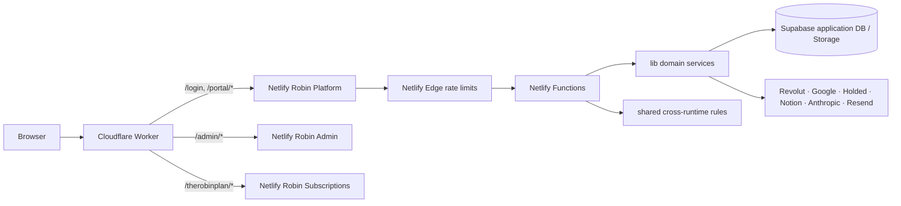

# Robin Platform — guía técnica extendida

## Rol del repositorio

Robin Platform contiene el portal de alumnos y la superficie administrativa del producto de aplicación, además del backend de Functions que sirve esas experiencias. Construye el frontend de `portal-source/` en `deploy/portal/`; las Netlify Functions y Edge Functions se empaquetan como runtime de servidor. La capa pública de `project-robin.com` está definida en `infrastructure/cloudflare/project-robin-router.js` y enruta por prefijos a tres proyectos Netlify distintos.

Este repo participa como proveedor principal de identidad y datos de aplicación. Robin Admin comparte su login desde el dominio público; The Robin Plan implementa identidad de suscriptor y almacenamiento por separado, con un endpoint SSO validado contra Platform.

## Arquitectura de runtime

Cloudflare conserva el origen WordPress para paths no reconocidos. Robin Platform posee un despliegue Netlify, no un API gateway propio; la ruta `/api/*` se resuelve en el proyecto origin a través de redirects de `netlify.toml`.

## Estructura y propiedad

### `portal-source/`

Aplicación React/Vite. `src/main.jsx` arranca React, `src/app.jsx` gestiona sesión, selección de administrador/alumno y onboarding, `src/api.js` es la fachada pública del cliente HTTP y reexporta módulos de `src/api/`. Las pantallas principales están separadas en `src/application/`, onboarding por pasos en `src/application/onboarding/`, administración en `src/application/admin/` y funciones de producto dentro de `src/application/` y `src/application/careers/`. Las reglas de permisos del menú se mantienen en `src/admin-permissions.js`; los controles de servidor siguen siendo autoridad.

Vite construye con base `/portal/`; Netlify publica `deploy/portal/` y copia los recursos descargables públicos. Las APIs usan same-origin cookies, excepto las subidas de binarios que reciben URLs firmadas desde el backend.

### `netlify/functions/`, `netlify/edge-functions/`, `lib/`, `shared/`

- Functions reciben peticiones, validan método/origen/session/roles y delegan reglas en `lib/`.
- Edge Functions aplican límites de abuso a rutas configuradas antes de entrar al handler.
- `lib/` ofrece integraciones backend y lógica reutilizable (Supabase, identity, pagos Revolut, PDFs, Google, Holded, Drive, calendario, Notion, email, IA y observabilidad).
- `shared/` guarda solo reglas que deben coincidir exactamente entre runtime Node y frontend (contrato, importes, roles y política de contraseña).

La asignación completa route → handler y handler → servicio está en [API_INVENTORY](docs/API_INVENTORY.md), [API_CONTRACTS](docs/API_CONTRACTS.md) y el [USERGUIDE](USERGUIDE.md).

## Flujo del alumno

1. `portal-source/src/app.jsx` llama `apiMe()` mediante `portal-source/src/api.js`.
2. Sin sesión, presenta login o el selector de portal en `/login`; con sesión, clasifica principal y rol.
3. Un alumno nuevo entra al primer paso pendiente de `application/onboarding/`: origen, DNI, contrato, perfil o checkout.
4. Cada paso llama endpoint de `/api/onboarding/*`; Functions accede a Supabase, firma URL de storage y usa proveedores según el paso.
5. El shell del portal muestra estado, perfil, pagos, carreras, documentos, reservas y FAQs de acuerdo con los flags y permisos actuales.

## Flujo de administración

El usuario administrativo se resuelve en `portal-source/src/app.jsx` y entra a `AdminPortal` si `isAdminUser()` lo confirma. Los componentes `Admin*` consultan datos por la misma fachada API; `portal-source/src/admin-permissions.js` delimita visibilidad de áreas y el backend verifica rol, alcance y ownership en cada Function. Robin Admin es otra superficie y otro despliegue: su UI de `/admin` consume identidad común vía `/portal/api/*` y API de gestión propia desde `/api/admin/*`.

## Identidad, persistencia e integraciones

- Cookie HttpOnly firmada en backend; `lib/auth.js`, `lib/identity.js` y `lib/authorization.js` centralizan principales, sesión y guards.
- Supabase es la DB de aplicación y storage; service-role key solo en Functions. Las tablas y accesos se describen en `docs/DATABASE_CURRENT.md` y `docs/AUTHORIZATION.md`.
- Revolut es el proveedor de checkout de aplicación (no Stripe); webhooks validan firma y reconciliación usa estado persistido e ID de pago.
- Google Drive, Sheets, Gmail, Calendar/Meet, Holded, Notion, Anthropic y Resend se encapsulan en `lib/`.
- `webhook_log` y servicios de reintento/idempotencia sostienen eventos externos; no reintentar pagos o emails sin confirmar ID/estado.

## Build, publicación y rutas

- Root package: backend y tooling; `portal-source/package.json`: frontend Vite/React.
- `netlify.toml` instala `portal-source`, construye y copia su `dist/` a `deploy/portal`, además declara funciones, redirects, headers, cron y Edge routes.
- `infrastructure/cloudflare/project-robin-router.js` maneja subpaths globales y preserva WordPress como fallback.
- Las guías existentes cubren operación en [OPERATIONS.md](docs/OPERATIONS.md), configuración en [ENVIRONMENT.md](docs/ENVIRONMENT.md), y flujos de host en [CLOUDFLARE_ROUTING.md](docs/CLOUDFLARE_ROUTING.md).

## Repositorios conectados

| Proyecto | Flujo compartido | Guías |
|---|---|---|
| [Robin Admin](https://github.com/RobinManuV/Robin-Admin) | Login, perfiles administrativos, leads, clientes e integraciones administrativas. | [README largo](https://github.com/RobinManuV/Robin-Admin/blob/main/READMELONG.md), [USERGUIDE](https://github.com/RobinManuV/Robin-Admin/blob/main/USERGUIDE.md), [arquitectura](https://github.com/RobinManuV/Robin-Admin/blob/main/docs/ARCHITECTURE.md). |
| [Robin Subscriptions](https://github.com/saantimartinn/robin-subscriptions) | Acceso cross-portal y SSO desde sesión de aplicación; usuario, cookie y base de datos de suscripción siguen separados. | [README largo](https://github.com/saantimartinn/robin-subscriptions/blob/main/READMELONG.md), [USERGUIDE](https://github.com/saantimartinn/robin-subscriptions/blob/main/USERGUIDE.md), [arquitectura](https://github.com/saantimartinn/robin-subscriptions/blob/main/docs/ARCHITECTURE.md). |

Los repos no comparten build, lockfile ni paquete de código. Los cambios de roles, shape de identidad, API o rutas requieren compatibilidad durante los despliegues independientes.
