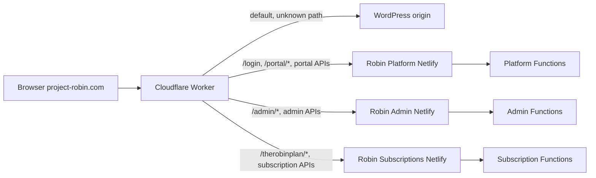

# Cloudflare y enrutamiento de Project Robin

## Fuente versionada y límites

El Worker se implementa en [`infrastructure/cloudflare/project-robin-router.js`](../infrastructure/cloudflare/project-robin-router.js); [infrastructure/cloudflare/README.md](../infrastructure/cloudflare/README.md) documenta su objetivo. Conserva WordPress como fallback y proxifica únicamente los patrones que `upstreamFor()` reconoce.

Los upstream origins (`santipruebas.netlify.app`, `robin-admin-platform.netlify.app`, `suscriptions-santi.netlify.app`) están codificados en Worker. El archivo no define por sí solo custom domains, DNS, zona, permisos de despliegue ni variables externas de Cloudflare.

### Snapshot del dashboard (20-10-2026)

La zona `project-robin.com` aparece activa con DNS Setup Full. En la vista DNS, los registros A de `@` y `www` apuntan a `75.2.60.5` con proxy Cloudflare activado; también hay un A proxied para `ftp`. Los demás registros mostrados incluyen correo y verificación, no forman parte del routing de aplicaciones. El apex no aparece entre las rutas del Worker, por lo que estas rutas de prefijo no capturan `/`.

La cuenta muestra el servicio `project-robin-router` en Production, con la versión `07430376` al 100% y marcada Ready; la publicación observada fue manual desde Dashboard hace 12 días. `workers.dev` está activo y no hay Custom Domains. El detalle **Domains and Routes** del servicio muestra seis rutas: `project-robin.com/admin*`, `/portal*`, `/therobinplan*`, `/login*`, `/api/internal/crm*` y `/api/admin*` (todas bajo el host `project-robin.com`). La pantalla general **Workers Routes** de la zona, abierta en la misma cuenta durante esta revisión, mostró “You do not have any routes configured”. Como las dos vistas no coinciden, registrar esta divergencia como estado pendiente de reconciliar. El resumen del servicio y sus seis patrones exactos se consideran observación del dashboard; no se infiere por qué la vista general los omite. Antes de cambiar host o publicar routing, comprobar de nuevo ambas pantallas.

## Topología

## Tabla de path mapping

| Path público | Origin elegido | Path enviado al origin | Regla |
|---|---|---|---|
| `/admin`, `/admin/` | Admin Netlify | `/` + query | coincidencia exacta |
| `/admin/<path>` | Admin Netlify | `/<path>` + query | elimina prefijo `/admin` |
| `/api/admin/*`, `/api/admin` | Admin Netlify | path original + query | API administrativa cross-origin |
| `/api/internal/crm/*` | Admin Netlify | path original + query | API interna CRM |
| `/login` o `/login/` | Platform Netlify | `/portal/` + query | selector convertido a entrada del portal |
| `/portal` | Platform Netlify | `/portal/` + query | normaliza la barra final |
| `/portal/api/*` | Platform Netlify | path sin `/portal` + query | `/portal/api/me` → `/api/me` |
| `/portal/*` | Platform Netlify | path original + query | conserva prefijo en los recursos del SPA |
| `/therobinplan` | Subscriptions Netlify | `/therobinplan/` + query | normaliza la barra final |
| `/therobinplan/api/*` | Subscriptions Netlify | path sin `/therobinplan` + query | `/therobinplan/api/me` → `/api/me` |
| `/therobinplan/*` | Subscriptions Netlify | path original + query | conserva el `base` Vite del SPA |
| cualquier otra ruta | Sin upstream Worker | request original | `fetch(request)` al origen WordPress / ruta Cloudflare existente |

El orden importa: las ramas `/portal/api/*` y `/therobinplan/api/*` preceden a los prefijos generales para quitar el path del portal solo a API.

## Headers, métodos y cuerpo

Para rutas proxificadas el Worker copia headers de request, asigna `X-Forwarded-Host` al host público y cambia `Origin` al origin elegido. Mantiene método y cuerpo (salvo GET/HEAD) y usa `redirect: "manual"`. Cookies y parámetros query se reenvían mediante el `Request` resultante. No convertir la llamada en `redirect` del navegador: eso expondría el hostname Netlify y cambia cookies/origin.

## Reescritura de assets del admin

Como Admin Netlify compila en la raíz, su HTML usa `/assets/...`. Para respuestas que entran por `/admin` el Worker:

1. solo inspecciona `text/html`, `text/css` y `javascript`;
2. sustituye referencias `/assets/` por `/admin/assets/`;
3. añade `?v=admin-20261008` a las referencias `/admin/assets/...` como clave de caché;
4. quita `content-length`, `content-encoding` y `etag`, porque el body cambió;
5. si un path `/admin/assets/*` upstream devuelve HTML, lo cambia a 404 `Admin asset not found`.

Si cambia el hash/versioning del cache bust, el build base o el prefijo de Admin, coordinar deploy de Worker y Admin. No mover scripts inline ni eliminar nonce: el CSP de Admin usa `robin-vite`.

## Segundo salto desde cada origin

### Robin Platform

`netlify.toml` redirige `/` a `/portal/`, construye `portal-source` y publica `deploy/portal`. Rutas `/api/*` se asignan a Functions, archivos SPA bajo `/portal/*` se atienden como estáticos/fallback y Edge rate-limits aplican solo a funciones configuradas. Ver [API inventory](API_INVENTORY.md) y [Operations](OPERATIONS.md).

### Robin Admin

Admin sirve SPA desde raíz del origin Netlify, con build `dist/`. El Worker elimina `/admin` al hacer proxy; su configuración Netlify mapea `/api/*` a handlers locales. El browser usa `/portal/api/*` para identidad compartida desde `/admin` y mantiene `/api/admin/*` en raíz, conforme a [`api-path.ts`](https://github.com/RobinManuV/Robin-Admin/blob/main/src/lib/api-path.ts).

### Robin Subscriptions

El `base` Vite es `/therobinplan/`; `dist/therobinplan` contiene su frontend. Netlify conserva `/api/*` local y las Functions corresponden a su propio proyecto/Supabase. El path SSO de sesión de aplicación es `/therobinplan/api/auth/sso` desde el browser público, llega a `/api/auth/sso` en origin. Ver [Subscriptions USERGUIDE](https://github.com/saantimartinn/robin-subscriptions/blob/main/USERGUIDE.md).

## Diagnóstico

1. Consultar path público y destino esperado en la tabla; revisar `upstreamFor()`.
2. Verificar status y `content-type` del origin directo y del host público.
3. En Admin, comparar HTML servido y asset path después de reescritura; el worker añade la versión al URL.
4. Confirmar que el API llegó al origin correcto: identity `/portal/api/*`, admin `/api/admin/*`, Plan `/therobinplan/api/*`.
5. Revisar reglas Netlify (redirects, SPA, Function route), Edge middleware y cookies del origin.
6. Paths no reconocidos deben continuar a WordPress; no agregarlos al Worker sin revisar colisión con WordPress.

## Referencias cruzadas

- [Robin Admin routing note](https://github.com/RobinManuV/Robin-Admin/blob/main/docs/CLOUDFLARE_ROUTING.md)
- [Robin Subscriptions routing note](https://github.com/saantimartinn/robin-subscriptions/blob/main/docs/CLOUDFLARE_ROUTING.md)
- [Worker source](../infrastructure/cloudflare/project-robin-router.js) · [Infrastructure README](../infrastructure/cloudflare/README.md)
