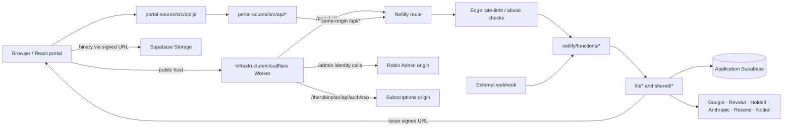

# Dataflow — Robin Platform cliente

Mapa funcional de cómo se mueven los datos por el portal de aplicación: navegador, API de mismo origen, Functions, reglas de dominio, persistencia e integraciones. Incluye los puntos donde Robin Admin y Robin Subscriptions consumen identidad o rutas de Platform. Para una ruta o campo concreto, confirma siempre el handler y su configuración.

> **Alcance:** sigue el flujo del software, no constituye una declaración legal de privacidad. Para categorías de datos, minimización, retención y borrado consulta [PRIVACY_DATA_MAP.md](PRIVACY_DATA_MAP.md). No se consultaron datos de producción.

## Vista general



Platform es el dueño de identidad/datos de aplicación. Robin Admin llama a sus APIs para operaciones compartidas de identidad y tiene su propia capa de administración/CRM. Subscriptions puede validar identidad Platform al efectuar SSO, pero emite después su cookie y conserva su base de suscriptores. El [router Cloudflare](../infrastructure/cloudflare/project-robin-router.js) enruta los prefijos públicos; las reglas y observaciones operativas están en [CLOUDFLARE_ROUTING.md](CLOUDFLARE_ROUTING.md).

## Convenciones de lectura

- La UI vive principalmente en `portal-source/src/`; [`portal-source/src/api.js`](../portal-source/src/api.js) es una fachada pública estable que reexporta módulos bajo `portal-source/src/api/`.
- `netlify.toml` conecta rutas públicas con handlers. [API_INVENTORY.md](API_INVENTORY.md) es índice generado/estático; el source del handler muestra validaciones y ramas reales.
- `netlify/edge-functions/` puede limitar/rechazar antes del handler. Luego `netlify/functions/` conserva método, origen, identidad, permisos y respuesta HTTP.
- `lib/` agrupa servicios/adaptadores; `shared/` contiene reglas/utilidades que se comparten entre contexts. No importes módulos Node-only desde navegador.
- Las credenciales de servicio se quedan en backend. El cliente solo recibe campos autorizados o URLs firmadas temporales.

## 1. Sesión de aplicación e identidad

### Login de usuario y lectura de sesión

```text
portal-source/src/app.jsx + auth UI
  → portal-source/src/api.js → api/auth-onboarding.js
  → /api/auth/*, /api/me
  → auth Function → lib/auth.js / identity modules
  → cookie firmada → siguiente petición /api/me
  → principal + capacidades → estado de React
```

El frontend conserva una interfaz de API estable a través de la fachada `api.js`; el módulo de sesión frontend se encuentra bajo `portal-source/src/session.js`. El servidor valida la cookie y devuelve el principal; login, logout y perfil tienen funciones específicas bajo `netlify/functions/`. El modelo de identidad se explica en [IDENTITY_MODEL.md](IDENTITY_MODEL.md), y permisos de rutas/mutaciones en [AUTHORIZATION.md](AUTHORIZATION.md).

No trates un campo `is_admin`, capability o nombre de rol enviado por el navegador como prueba. Para operaciones protegidas, el handler vuelve a recuperar identidad y aplica guard. Diferencia 401 (sesión ausente/no válida), 403 (scope insuficiente) y errores de dependencia.

### Identidad consumida por otros productos

- **Robin Admin:** en el dominio compartido, las rutas de identidad se sirven bajo `/portal/api/*`; Cloudflare las resuelve hacia Platform. Los endpoints administrativos CRM/datos permanecen en el origin Admin. Ver [Admin DATAFLOW](https://github.com/RobinManuV/Robin-Admin/blob/main/docs/DATAFLOW.md).
- **Robin Subscriptions:** su handler `auth-sso` consulta la identidad de aplicación desde backend, enlaza una cuenta local de suscriptor y crea una sesión local propia. No se comparte JWT secret, tabla de sesión ni base de Subscriptions. Ver [Subscriptions DATAFLOW](https://github.com/saantimartinn/robin-subscriptions/blob/main/docs/DATAFLOW.md).

Cambiar respuesta de `/api/me`, roles, capabilities, IDs, expiración o cookie es un cambio de contrato. Sigue todos los consumidores antes de retirar o renombrar campos.

## 2. Aplicación, perfil y onboarding

El formulario que controla una etapa del expediente recoge datos y envía acciones mediante módulos de `portal-source/src/api/`. Rutas de onboarding bajo `/api/onboarding/*` terminan en Functions que validan sesión/estado y delegan en lógica de perfil, contrato o pago.

```text
onboarding/profile UI → api/onboarding.js → /api/onboarding/profile
  → onboarding-profile Function → validation + principal
  → application tables → updated state returned to UI
```

No todos los formularios escriben en la misma tabla ni cada paso usa el mismo guard. Para cualquier cambio de campos identifica el escritor, lector, tipo/nullable de columna, etapa que habilita la escritura y pantallas dependientes. Consulta [DATABASE_CURRENT.md](DATABASE_CURRENT.md) para un snapshot, y confirma el schema versionado/migración antes de alterar datos.

Operaciones administrativas de alumnos usan rutas `/api/admin/*`, principalmente handlers `admin-clients-*`, `admin-documents-*`, `admin-careers-*`, payments, dashboard y notificaciones. UI y API aplican capacidades diferentes; el servidor es autoridad de acceso. El inventario indica handler y tablas detectadas; [API_CONTRACTS.md](API_CONTRACTS.md) y el código definen el contrato detallado.

## 3. Documentos y archivos binarios

Los binarios académicos o de identidad no deberían viajar como JSON grande a Netlify. El flujo típico usa un ticket firmado:

```text
Browser → /api/documents/upload-ticket (metadata)
  → Function checks session, owner, bucket/path, MIME and size
  → short-lived signed Storage URL returned
Browser → Supabase Storage (binary upload)
  → document save/confirm Function → metadata row
  → authorized list/download Function → signed URL or controlled response
```

La validación del ticket fija usuario, bucket/ruta, tipo y tamaño; no es un permiso general de Storage. Los handlers de documentos y helpers de `lib/` coordinan metadata, objetos y operaciones externas como Drive/OCR. Un upload exitoso de bytes no implica que el flujo de expediente completo haya guardado la metadata; trata esos resultados como fases distintas.

Para un cambio revisa creación/emisión de ticket, subida, confirmación, listado, descarga, revisión admin y borrado. También revisa objetos huérfanos, retries, ownership y URLs expuestas en logs. [BROWSER_SECURITY.md](BROWSER_SECURITY.md) describe controles de cliente; [PRIVACY_DATA_MAP.md](PRIVACY_DATA_MAP.md) identifica destinos y retención.

## 4. Pagos, contrato y facturación

Los endpoints de onboarding/payment llevan el pedido al backend. Allí se valida cuenta, concepto/importes y configuración de proveedor. Platform integra pagos con Revolut; handlers reciben/validan callbacks o webhooks y módulos de `lib/` actualizan la representación local y procesos ligados a factura/contabilidad.

```text
Checkout UI → API client → payments/onboarding Function
  → principal + plan/amount validation → Revolut checkout
  → browser redirect (informativo)
  → signed provider webhook / server verification
  → persisted payment state → APIs/dashboard → UI
```

La URL de retorno no es la confirmación autoritativa. Sigue el evento autenticado del proveedor hasta el cambio persistente y las tareas de sincronización (por ejemplo, Holded/Sheets según handler/configuración). Para revisar finanzas/admin, traza también quién agrega los datos y qué campo se deriva de cada proveedor. Nunca confíes en un importe calculado solo en React.

## 5. Carreras, reservas, chat y comunicación

- **Carreras y asesoría:** el usuario/perfil suministra el contexto; APIs de carreras y sugerencias consultan tablas de dominio y, donde corresponda, un servicio AI; backend almacena asignación/feedback y devuelve una vista autorizada.
- **Reservas/Calendar/Meet:** availability/create handlers aplican reglas de calendario, verifican identity y previenen dobles reservas. Los eventos o transcripciones pueden disparar ingesta/summarization; sigue entrada de Meet/Drive a la Function y almacenamiento del resultado.
- **Chat y FAQ:** el frontend envía mensajes/contexto limitado; la Function aplica sesión, límites y reglas de acceso, llama al servicio Anthropic cuando procede y guarda el historial conforme al helper de dominio.
- **Email/notificaciones:** una acción backend puede persistir notification state y enviar Resend/email. Un email enviado no garantiza que el estado de UI de notificación haya cambiado, y viceversa.

Para cualquiera de estos flujos abre el endpoint específico en [API_INVENTORY](API_INVENTORY.md) y consulta la implementación en el handler, `lib/` y tabla. La lista en esta página indica el camino típico, no que todos los proveedores se llamen en cada request.

## 6. Integraciones entrantes y tareas automáticas

Notion, webhooks de pago, Meet/Calendar y otros sistemas pueden iniciar un flujo sin interacción React. Su punto de entrada es una Function o schedule definido por código/configuración:

```text
external event / scheduled invocation
  → verify signature/token or scheduled context
  → parse + validate + normalize
  → idempotency / dedupe
  → domain service → DB and/or external provider
  → structured result + retry/error handling
```

En webhooks, verifica autenticidad antes de confiar en body o actualizar estado; reconoce el mismo event ID al reintentar. En schedules, encuentra la configuración en `netlify.toml` y documenta la ventana, paginación, retries y si la escritura es idempotente. El [API inventory](API_INVENTORY.md) no representa por sí solo todas las funciones programadas o llamadas directas.

## Cómo investigar una fila, campo o petición

1. Busca el nombre del campo/entidad en `portal-source/src/`, `netlify/functions/`, `lib/`, `shared/` y migraciones.
2. Identifica quién lo escribe y qué petición inicia la escritura.
3. Resuelve URL en `netlify.toml`; si es pública, determina transformación en Worker.
4. Lee auth, permiso, ownership y validación del handler.
5. Sigue servicio a tabla/bucket o proveedor y localiza lectura(s) posterior(es).
6. Comprueba error parcial, retry, idempotencia y consumidores en otros repos.
7. Usa [FILE_MAP](FILE_MAP.md) y [índice por archivo](codebase/README.md) para seguir imports; confirma todo en source.

### Referencias

- [USERGUIDE](../USERGUIDE.md) · lectura por capa.
- [Arquitectura](ARCHITECTURE.md) · límites del portal.
- [API contracts](API_CONTRACTS.md) y [API inventory](API_INVENTORY.md).
- [Identidad](IDENTITY_MODEL.md), [autorización](AUTHORIZATION.md), [base de datos](DATABASE_CURRENT.md).
- [Cloudflare routing](CLOUDFLARE_ROUTING.md).
- [Mapa de archivos](FILE_MAP.md) y [índice codebase](codebase/README.md).
- [Privacidad y datos personales](PRIVACY_DATA_MAP.md).
